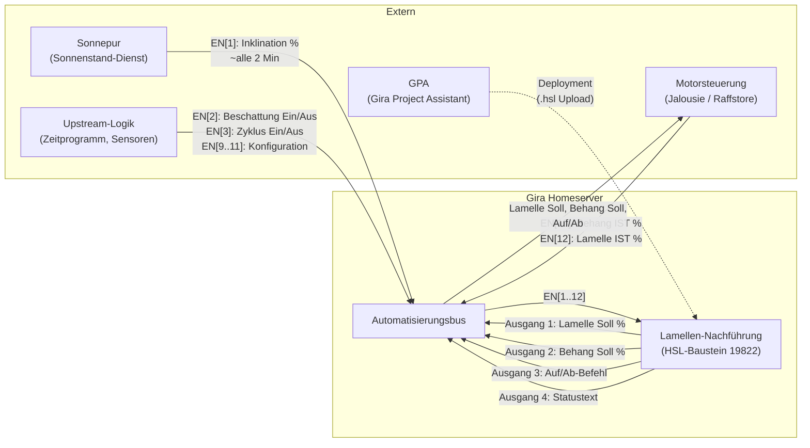

# §03 Kontextabgrenzung

(Source: CLAUDE.md § Projektübersicht, § Variablenreferenz;
SourceDocuments/SpecsAndRequirments/anforderungen.md F-01–F-08)

---

## Systemgrenze

Der Baustein **Jalousie Lamellennachführung** ist ein HSL-Baustein, der innerhalb des
Gira-Homeserver-Laufzeitsystems ausgeführt wird. Er hat keinen direkten Zugriff auf externe
Netzwerkdienste, Datenbanken oder Betriebssystemressourcen. Alle Kommunikation erfolgt über
den Gira-Automatisierungsbus über die definierten Eingänge (`EN[1]`–`EN[12]`) und
Ausgänge (1–4).

---

## Fachlicher Kontext

---

## Technischer Kontext

### Eingänge (EN)

| Eingang | Beschreibung | Herkunft |
|---------|-------------|---------|
| `EN[1]` | Sonnen-Inklination (%) — Trigger ca. alle 2 Minuten | Sonnepur-Dienst |
| `EN[2]` | Beschattung Ein (1) / Aus (0) | Upstream-Logik (Zeitplan, Sensor) |
| `EN[3]` | Zyklus Ein (1) / Aus (0) — Aktiviert Behang-Automatik | Upstream-Logik |
| `EN[4]` | Mindeständerung / Toleranz (%) | Konfigurationsparameter (GPA) |
| `EN[5]` | Lamellenstellung waagrecht (%) | Konfigurationsparameter (GPA) |
| `EN[6]` | Lamellenstellung senkrecht (%) | Konfigurationsparameter (GPA) |
| `EN[7]` | Lamellenstellung bei Beschattung Aus (%) | Konfigurationsparameter (GPA) |
| `EN[8]` | Offset Lamellenwinkel +/- (%) | Konfigurationsparameter (GPA) |
| `EN[9]` | Behang-Zielposition bei Sonnenschutz (%) | Konfigurationsparameter / Upstream |
| `EN[10]` | Behang IST-Position (%) | Motorsteuerung (Rückmeldung) |
| `EN[11]` | Steuerung: 1 = Behang AUF bei Beschattung AUS | Konfigurationsparameter (GPA) |
| `EN[12]` | Lamelle IST-Position (%) — **0 bei Jalousie, >0 bei Raffstore** | Motorsteuerung / Jalousie-Typ |

### Ausgänge

| Ausgang | Beschreibung | Ziel |
|---------|-------------|------|
| Ausgang 1 (`sbC`) | Lamellen-Sollwert (%) | Motorsteuerung (Lamelle) |
| Ausgang 2 (`send`) | Behang-Sollwert (%) | Motorsteuerung (Behang) |
| Ausgang 3 | Auf/Ab-Befehl | Motorsteuerung (Fahrtrichtung) |
| Ausgang 4 | Statustext (Debug-String) | Gira-Bus (Diagnose / Visualisierung) |

---

## Externe Schnittstellen

| Schnittstelle | Richtung | Protokoll / Format | Beschreibung |
|--------------|----------|-------------------|-------------|
| Sonnepur | → Eingang | Gira-Bus-Analogwert | Inklinationswert 0–100 %, Trigger ca. alle 2 Min. |
| Motorsteuerung | ↔ bidirektional | Gira-Bus-Analog + Digital | Sollwerte aus, IST-Position zurück |
| Upstream-Logik | → Eingang | Gira-Bus-Binär/Analog | Beschattung, Zyklus, Konfigurationswerte |
| GPA | → Deployment | Proprietäres Gira-Protokoll | Einmalig: `.hsl`-Datei hochladen |

---

*Siehe auch:* [§05 Bausteinsicht](05-building-block-view.md) für die interne Struktur |
[§12 Glossar](12-glossary.md) für Begriffsdefinitionen
