# §05 Bausteinsicht

(Source: CLAUDE.md § Logik-Architektur, § Variablenreferenz;
`19822_Jalousie Lamellennachführung_optimiert.hsl`;
ADR-001 bis ADR-006)

---

## Ebene 1 — Schwarze Box

Der Baustein als Ganzes aus Sicht des Gira-Homeserver-Projekts:

| Element | Beschreibung |
|---------|-------------|
| **Name** | Jalousie Lamellennachführung (Baustein-ID 19822) |
| **Version** | V 3.2.5 |
| **Zweck** | Automatische Sonnenstandsnachführung für Jalousien und Raffstoren mit Manuell-Vorrang |
| **Eingänge** | 12 (EN[1]–EN[12]), siehe [§03](03-context-and-scope.md) |
| **Ausgänge** | 4 (Lamelle %, Behang %, Auf/Ab, Statustext) |
| **Interner Zustand** | 7 Speicherregister (SN[1]–SN[7]) |
| **Laufzeitmodell** | Zyklusbasiert, sequentielle Regelauswertung von oben nach unten |

---

## Ebene 2 — Logikabschnitte (Weißglas-Sicht)

Der Baustein ist in **11 funktionale Abschnitte** gegliedert, die pro Zyklus in dieser
Reihenfolge ausgewertet werden. Spätere Abschnitte lesen Werte, die frühere Abschnitte
in demselben Zyklus geschrieben haben.

(Source: CLAUDE.md § Logik-Architektur)

```mermaid
flowchart TD
    IN["**Eingänge**\nEN[1..12]"]

    S1["**§1 Sollwertberechnung**\nSN[2] = Inklinationsformel\noder EN[7] (Beschattung Aus)\nClamp auf [EN[5], EN[6]]"]

    S2["**§2 Positions-Flags**\nSN[3] = Behang in Ziel ±3%\nSN[4] = Lamelle weicht ab"]

    S3["**§3 Manuell-Vorrang-Erkennung**\nSN[5] = 0 wenn EN[12] von SN[2]\nabweicht (Guards: SN[6], EN[12]<98,\nnot EC[2])"]

    S4["**§4 Behang-Automatik**\nEC[3] Steigende Flanke →\nAusgang 2 = EN[9]\nSN[6]=1, SN[7]=Sollwert\nJalousie: nur wenn EN[10]<EN[9]"]

    S5["**§5 Lamellen-Nachführung EC[10]**\nBehang ankommt ±3%:\nAusgang 1 = SN[2] oder EN[7]"]

    S6["**§6 Abfahrt-Flag Reset**\nRaffstore: EC[12] + EN[12]<98\nJalousie: EC[10] + Ankunft"]

    S7["**§7 Lamellen-Nachführung EC[1]**\nInklinations-Änderung:\nnur bei SN[6]==0, SN[3]==1,\nSN[5]>0, Schwelle ≥EN[4]"]

    S8["**§8 Lamellen-Nachführung EC[2]**\nBeschattungs-Umschalten:\nSofort auf neuen Sollwert"]

    S9["**§9 Manuell-Vorrang-Rücknahme**\nSN[5] = 1 wenn IST wieder\nin Toleranz von SN[2]"]

    S10["**§10 Timeout**\nSN[6]==1 → 0\nnach 180 Sekunden"]

    S11["**§11 Statustext**\nImmer: Ausgang 4 =\nDebug-String aller SN-Werte"]

    OUT["**Ausgänge**\n1: Lamelle % | 2: Behang %\n3: Auf/Ab | 4: Statustext"]

    IN --> S1 --> S2 --> S3 --> S4 --> S5 --> S6 --> S7 --> S8 --> S9 --> S10 --> S11 --> OUT
```

---

## Abschnitts-Steckbriefe

### §1 — Sollwertberechnung
**Trigger:** Jeder Zyklus (immer)
**Liest:** EN[1] (Inklination), EN[2] (Beschattung), EN[5], EN[6], EN[7], EN[8]
**Schreibt:** `SN[2]`
**Logik:** Bei Beschattung ein → Inklinationsformel; bei Beschattung aus → EN[7]. Clamp auf [EN[5], EN[6]].

### §2 — Positions-Flags
**Trigger:** Jeder Zyklus
**Liest:** EN[9], EN[10], EN[12], SN[2], EN[4], EN[2], EN[7]
**Schreibt:** `SN[3]`, `SN[4]`
**Logik:** `SN[3] = abs(EN[9]-EN[10])<=3`; `SN[4]` nur bei Raffstore. `SN[4]` ist derzeit nur diagnostisch genutzt.

### §3 — Manuell-Vorrang-Erkennung
**Trigger:** Jeder Zyklus (nur Raffstore: `EN[12]>0`)
**Guards:** `SN[6]==0` (kein Abfahrt-Flag, ADR-002), `EN[12]<98` (Endlage, ADR-004), `not EC[2]` (Übergangsmaskierung, ADR-005)
**Schreibt:** `SN[5] = 0` wenn Abweichung > EN[4]

### §4 — Behang-Automatik
**Trigger:** `EC[3]` (steigende Flanke von EN[3])
**Jalousie** (EN[12]==0): Abfahrt nur wenn `EN[10]<EN[9]` (ADR-006)
**Raffstore** (EN[12]>0): Abfahrt wenn `SN[3]==0`
**Schreibt:** Ausgang 2 (Behang-Ziel), `SN[6]=1`, `SN[7]`=Lamellen-Sollwert während Abfahrt
**Zyklus-Aus:** Ausgang 3 (Auf-Befehl)

### §5 — Lamellen-Nachführung bei Behang-Ankunft
**Trigger:** `EC[10]` (Behang-Position ändert sich) + `abs(EN[9]-EN[10])<=3`
**Schreibt:** Ausgang 1 (SN[2] bei Beschattung ein, EN[7] bei Beschattung aus), `SN[7]`, `SN[5]=1`
**Hinweis:** Feuert **ohne** `SN[6]`-Prüfung (ADR-003)

### §6 — Abfahrt-Flag Reset
**Trigger Raffstore:** `EC[12]` + `SN[6]==1` + `EN[12]<98`
**Trigger Jalousie:** `EC[10]` + Behang ankommt + `SN[6]==1`
**Schreibt:** `SN[6]=0`
**Hinweis:** Reset erst nach Lamellenbewegung, nicht bei Behang-Ankunft (ADR-003)
**Zusatz:** Wenn Beschattung ändert und Automatik aktiv: fährt Lamelle sofort auf neuen SN[2]

### §7 — Lamellen-Nachführung bei Inklinationsänderung
**Trigger:** `EC[1]` (Inklination ändert sich)
**Bedingungen:** `SN[6]==0` (kein Abfahrt), `SN[3]==1` (Behang in Ziel), `SN[5]>0` (Automatik aktiv)
**Raffstore:** zusätzlich `abs(SN[2]-SN[1])>=EN[4]` (Mindeständerung)
**Schreibt:** Ausgang 1 (neuer Lamellen-Sollwert)

### §8 — Lamellen-Nachführung bei Beschattungsänderung
**Trigger:** `EC[2]` (Beschattung schaltet)
**Schreibt:** Ausgang 1 (sofort SN[2] oder EN[7])
**Hinweis:** Schreibt auch SN[7] und nutzt `SN[5]>0` (bzw. SN[6]==1-Zweig für Abfahrt-Zustand)

### §9 — Manuell-Vorrang-Rücknahme
**Trigger:** Jeder Zyklus
**Bedingungen:** `SN[6]==0`, `EN[12]<98`, `not EC[2]`, IST innerhalb Toleranz
**Schreibt:** `SN[5]=1` wenn Lamelle/Behang wieder im Sollwertbereich

### §10 — Timeout
**Trigger:** `SN[6]==1` mit Timeout 180 Sekunden
**Schreibt:** `SN[6]=0` nach 180 s
**Zweck:** Sicherheits-Fallback wenn normaler Reset-Pfad nicht feuert (ADR-002)

### §11 — Statustext
**Trigger:** Immer (keine Bedingung)
**Schreibt:** Ausgang 4 = `'S2:'+str(int(SN[2]))+' S5:'+str(int(SN[5]))+' S3:'+...`

---

## Schreib/Lese-Matrix (SN-Register)

| Register | Schreibt | Liest |
|----------|---------|-------|
| SN[1] | §7 (nach Senden) | §7 (Schwellwertvergleich) |
| SN[2] | §1 | §3, §4, §5, §6, §7, §8, §9, §11 |
| SN[3] | §2 | §4, §6 |
| SN[4] | §2 | §11 (nur diagnostisch) |
| SN[5] | §3 (=0), §4 (=1), §5 (=1), §9 (=1) | §4, §7, §8, §11 |
| SN[6] | §4 (=1), §6 (=0), §10 (=0) | §3, §7, §8, §9, §11 |
| SN[7] | §4, §5, §6, §8 | §11 |

---

*Siehe auch:* [§06 Laufzeitsicht](06-runtime-view.md) für dynamische Szenarien |
[§04 Lösungsstrategie](04-solution-strategy.md) für das Regelmodell
