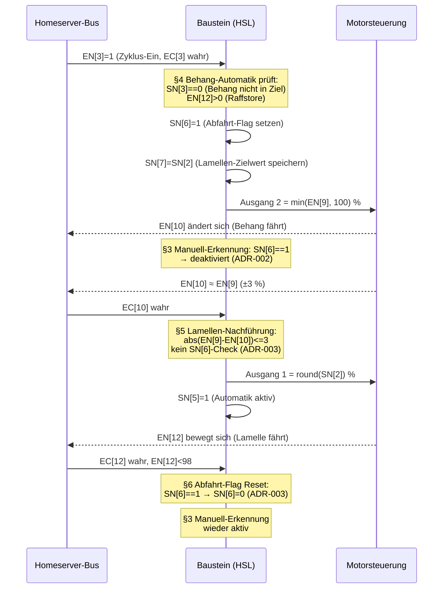
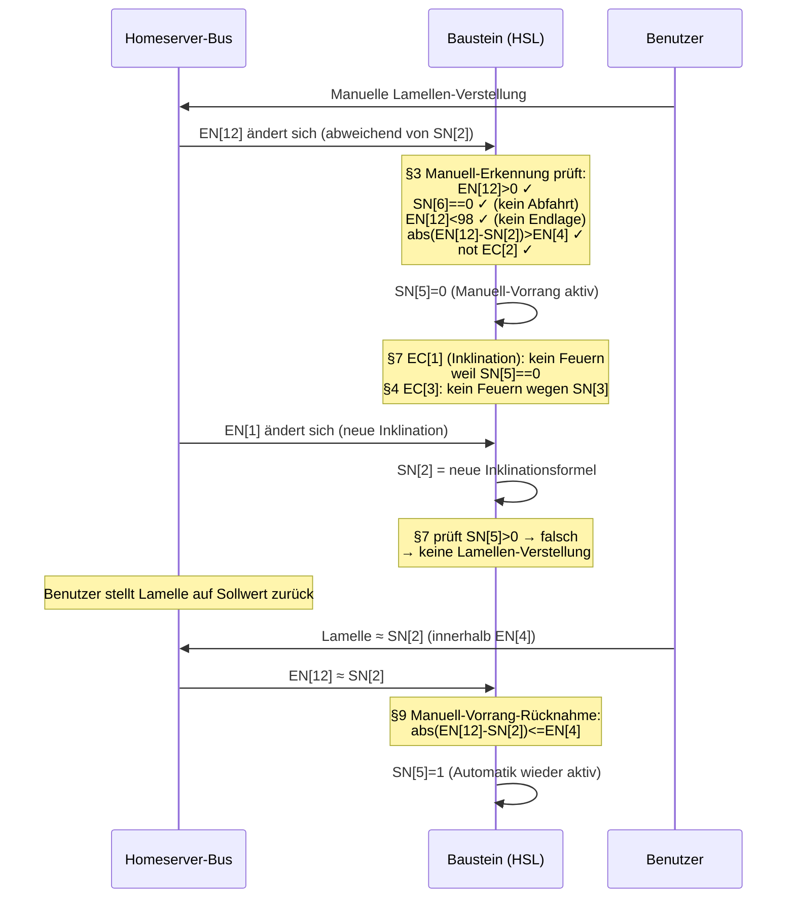
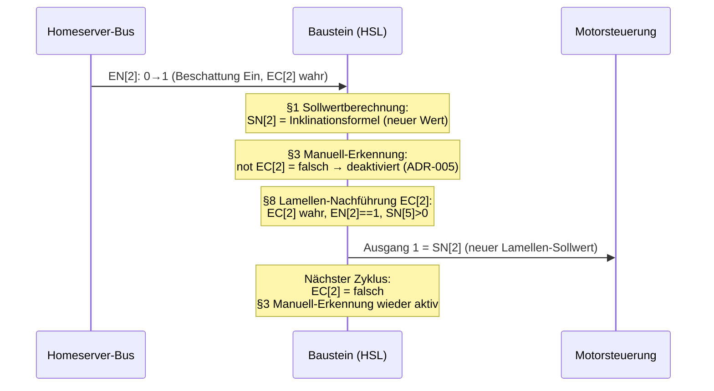
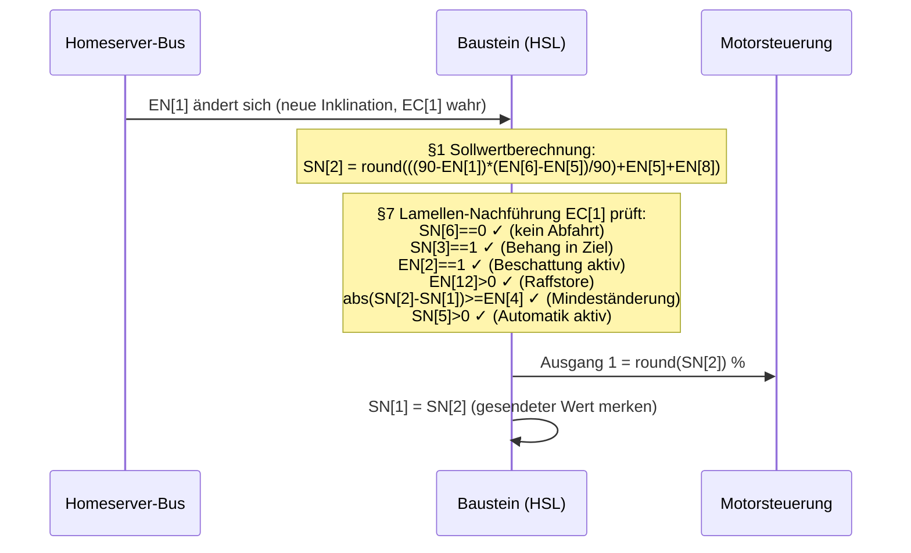

# §06 Laufzeitsicht

(Source: CLAUDE.md § Logik-Architektur;
`19822_Jalousie Lamellennachführung_optimiert.hsl` Zeilen 80–170;
ADR-002, ADR-003, ADR-005, ADR-006)

Vier Schlüsselszenarien zeigen das Laufzeitverhalten des Bausteins.

---

## Szenario 1 — Normalbetrieb Raffstore: Zyklus-Trigger → Abfahrt → Lamellen-Nachführung

Ausgelöst durch steigende Flanke von EN[3] (Zyklus-Ein), wenn Behang nicht in Zielposition.

---

## Szenario 2 — Manuell-Vorrang: Erkennung und automatische Rücknahme

Ausgelöst wenn der Benutzer die Lamelle manuell verstellt (Raffstore mit Feedback).

---

## Szenario 3 — Beschattungs-Umschalten (Übergangsmaskierung)

Ausgelöst wenn Beschattung von Aus auf Ein (oder umgekehrt) wechselt (EC[2]).

---

## Szenario 4 — Inklinationsänderung während Automatikbetrieb (Raffstore)

Ausgelöst wenn Sonnepur eine neue Inklination sendet (EC[1]), ca. alle 2 Minuten.

> ⚠️ Inferred: Für **Jalousien** (EN[12]==0) entfällt die `abs(SN[2]-SN[1])>=EN[4]`-Prüfung
> in §7 — die Lamelle wird bei jeder Inklinationsänderung direkt nachgeführt.
> (Source: .hsl Zeilen 129–130 vs. 131)

---

## Timeout-Fallback (Sicherheitsszenario)

Falls der normale SN[6]-Reset-Pfad nicht feuert (z. B. kein Motorpositions-Feedback):

- §10 feuert nach 180 Sekunden mit `SN[6]==1` (Timeout-Bedingung in .hsl Zeile 163)
- `SN[6]` wird auf 0 gesetzt
- Manuell-Erkennung wird wieder aktiviert

(Source: ADR-002; .hsl Zeile 163)

---

*Siehe auch:* [§05 Bausteinsicht](05-building-block-view.md) für die Abschnitts-Steckbriefe |
[§09 Architekturentscheidungen](09-architecture-decisions.md) für ADR-Begründungen
