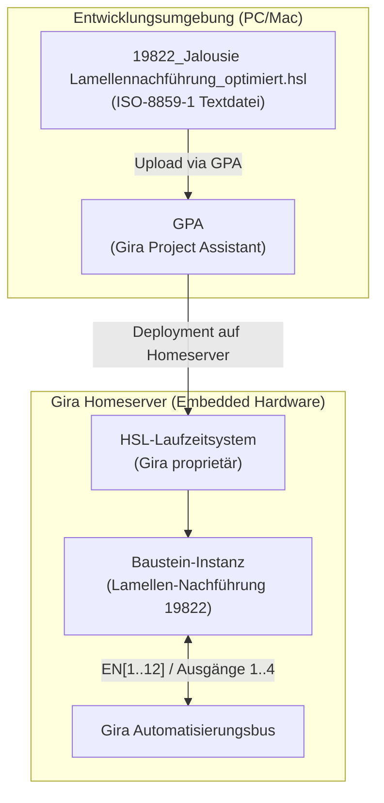

# §07 Verteilungssicht

(Source: CLAUDE.md § Projektübersicht;
SourceDocuments/SpecsAndRequirments/anforderungen.md OQ-01, OQ-03)

---

## Deployment-Topologie

Das System besteht aus einer einzigen laufzeitfähigen Datei, die direkt auf den
Gira Homeserver geladen wird. Es gibt keine verteilten Komponenten, keine Netzwerkkommunikation
außerhalb des Homeservers und keine Cloud-Abhängigkeiten.

---

## Deployment-Schritte

1. `.hsl`-Datei in GPA (Gira Project Assistant) öffnen
2. Projekt auf den Gira Homeserver compilieren und laden
3. Baustein-Instanz im Projekt verdrahten (Eingänge EN[1]–EN[12] und Ausgänge beschalten)
4. Konfigurationsparameter EN[4]–EN[9] im GPA setzen
5. Betrieb beobachten über Statustext-Ausgang 4

**Kein automatisierter Deployment-Prozess.** Kein CI/CD. Kein Rollback-Mechanismus außer
Wiedereinladen der vorherigen `.hsl`-Datei über GPA.

(Source: CLAUDE.md § Projektübersicht)

---

## Mehrere Instanzen

> 📝 TODO (OQ-03): Ist der gleichzeitige Betrieb mehrerer Instanzen des Bausteins in einem
> Homeserver-Projekt (z. B. eine pro Jalousie) ohne Einschränkungen möglich? Jede Instanz
> verwaltet ihren eigenen SN-Zustand unabhängig — das deutet darauf hin, dass Mehrfachinstanzen
> unterstützt sind, ist aber nicht explizit verifiziert.

> ⚠️ Inferred: Da SN-Register instanzlokal sind, interferieren mehrere Instanzen nicht.

---

## Umgebungen

Es existiert keine Unterscheidung zwischen Staging- und Produktionsumgebung.
Änderungen werden direkt auf dem Produktionssystem (dem physischen Gira Homeserver) getestet.

> 📝 TODO (OQ-01): Welche minimale Gira-Homeserver-Firmware-Version wird vorausgesetzt?
> Relevant für Kompatibilitätszusagen bei zukünftigen Homeserver-Updates.

---

*Siehe auch:* [§02 Randbedingungen](02-constraints.md) für Deployment-Constraints |
[§11 Risiken](11-risks-and-technical-debt.md) für Risiken dieses Deployment-Modells
