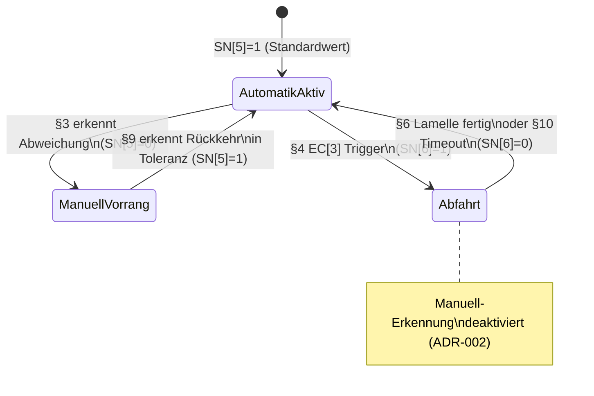

# §08 Querschnittliche Konzepte

(Source: CLAUDE.md § Logik-Architektur, § Zeichenkodierung, § Variablenreferenz;
`19822_Jalousie Lamellennachführung_optimiert.hsl` Zeilen 163, 170;
ADR-002, ADR-003, ADR-004, ADR-005)

---

## 1. Sicherheits-Timeout (Safety Fallback)

**Problem:** Wenn der normale SN[6]-Reset-Pfad nicht feuert (z. B. kein Bus-Feedback von der
Motorsteuerung), bleibt das Abfahrt-Flag dauerhaft gesetzt, und die Manuell-Erkennung ist
permanent deaktiviert.

**Lösung:** 5012-Regel mit Timeout-Parameter:
```
5012|0|"SN[6]==1"|"0"|"180"|0|0|6|0
```
Wenn `SN[6]==1` für 180 Sekunden ununterbrochen wahr bleibt, wird `SN[6]` auf 0 gesetzt.

**Implikation:** Der Timeout-Wert muss größer als die maximal mögliche Fahrtdauer von Behang
und Lamelle sein. Der aktuelle Wert (180 s) ist ein konservativer Richtwert.

(Source: ADR-002; .hsl Zeile 163)

> 📝 TODO (OQ-02): Was ist die maximale Fahrtzeit für die installierten Jalousien/Raffstoren?
> Dieser Wert sollte den 180-s-Timeout validieren oder eine Anpassung erfordern.

---

## 2. Debug-Observabilität (Statustext)

**Problem:** Der interne Zustand des Bausteins (SN-Register) ist ohne Diagnose-Ausgang nicht
sichtbar. Fehler sind schwer zu reproduzieren, da die Hardware nicht direkt debuggt werden kann.

**Lösung:** Eine immer feuernde 5012-Regel (keine Bedingung) schreibt alle relevanten
Zustandswerte als formatierten String auf Ausgang 4:
```
'S2:'+str(int(SN[2]))+' S5:'+str(int(SN[5]))+' S3:'+str(int(SN[3]))+
' S4:'+str(int(SN[4]))+' S1:'+str(int(SN[1]))+' S6:'+str(int(SN[6]))+
' S7:'+str(int(SN[7]))+' Li:'+str(int(EN[12]))
```
Dieser String kann im GPA oder in einem Homeserver-Visualisierungs-Element angezeigt werden.

**Format:** `S2:<Sollwert> S5:<Automatik> S3:<Behang-in-Ziel> S4:<Lamelle-ab> S1:<letzter-Soll> S6:<Abfahrt> S7:<Ziel-während-Abfahrt> Li:<Lamelle-IST>`

(Source: CLAUDE.md § Logik-Architektur §11; .hsl Zeile 170)

---

## 3. Toleranzband-Konzept

Zwei verschiedene Toleranzen werden im gesamten Baustein konsistent verwendet:

| Toleranz | Wert | Verwendung | Betroffene Abschnitte |
|---------|------|-----------|----------------------|
| Behang-Positionstoleranz | ±3 % (fest) | SN[3]: Behang gilt als "in Zielposition" | §2, §5, §6 |
| Lamellen-Toleranz | EN[4] % (konfigurierbar) | Manuell-Erkennung, EC[1]-Mindeständerung | §3, §7, §9 |

Die Behang-Toleranz ist hardcodiert (3 %); die Lamellen-Toleranz ist über EN[4] konfigurierbar
und erlaubt Anpassung an unterschiedliche Motorgenauigkeiten.

(Source: CLAUDE.md § Variablenreferenz; .hsl Zeilen 55, 70)

---

## 4. Datei-Kodierung (ISO-8859-1)

**Constraint:** Die `.hsl`-Datei muss in **ISO-8859-1** (Latin-1) kodiert sein.

**Implikation für Entwicklung:** Jeder Texteditor, der die Datei bearbeitet, muss explizit
auf Latin-1 eingestellt werden. Standardmäßig öffnen moderne Editoren Dateien als UTF-8;
ein Speichern in UTF-8 korrumpiert alle Umlaut-Zeichen (ä, ö, ü, ß) in Kommentaren und
Strings lautlos. Der Fehler ist erst nach dem GPA-Upload sichtbar.

**Betroffene Zeichen in der Datei:** Kommentare (Überschriften wie `# Sollwertberechnung Lamelle`),
der Baustein-Anzeigename im 5000-Header.

(Source: CLAUDE.md § Zeichenkodierung; anforderungen.md NF-02)

---

## 5. Zustandsmaschinen-Muster (SN-Register)

Der Baustein hat keinen expliziten Zustandsmaschinen-Framework, implementiert aber eine
implizite Zustandsmaschine durch die Kombination von SN-Registern:



(Source: ADR-002; CLAUDE.md § Logik-Architektur)

---

*Siehe auch:* [§04 Lösungsstrategie](04-solution-strategy.md) für das Regelmodell |
[§11 Risiken](11-risks-and-technical-debt.md) für Risiken der Kodierungsconstraint
