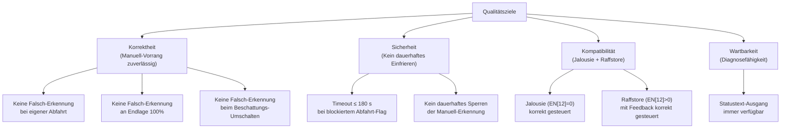

# §10 Qualitätsanforderungen

(Source: SourceDocuments/SpecsAndRequirments/anforderungen.md NF-01–NF-03, OQ-02, OQ-04;
CLAUDE.md § Logik-Architektur; ADR-002, ADR-004, ADR-005)

> **Hinweis:** Das Anforderungsdokument hat den Status **Draft** und ist noch nicht formal
> abgenommen. Quantitative Qualitätsziele (SLOs, Falsch-Erkennungsraten) sind nicht definiert.
> Offene Fragen OQ-01 bis OQ-04 sind unbeantwortet.

---

## Qualitätsbaum

---

## Qualitätsszenarien

### NF-01: Sicherheits-Timeout

| Attribut | Beschreibung |
|----------|-------------|
| **Anforderung** | Ein blockiertes Abfahrt-Flag darf die Manuell-Erkennung nicht dauerhaft deaktivieren |
| **Stimulus** | Motorpositions-Feedback bleibt aus (Bus-Fehler, Sensor-Ausfall) |
| **Antwort** | SN[6] wird nach 180 Sekunden automatisch auf 0 zurückgesetzt |
| **Messbar** | Timeout-Wert in .hsl Zeile 163 muss ≤ maximale Fahrtzeit (OQ-02 ausstehend) |
| **Quelle** | anforderungen.md NF-01; ADR-002 |

### NF-02: Datei-Kodierung

| Attribut | Beschreibung |
|----------|-------------|
| **Anforderung** | Die `.hsl`-Datei muss nach jeder Änderung korrekt in ISO-8859-1 gespeichert sein |
| **Stimulus** | Entwickler öffnet und speichert die Datei in einem Editor |
| **Antwort** | Datei bleibt in ISO-8859-1; keine Umlaut-Korrumpierung |
| **Messbar** | Datei-Kodierung mit `file -I` oder Editor-Anzeige verifizierbar; GPA zeigt korrekten Baustein-Namen |
| **Quelle** | anforderungen.md NF-02; CLAUDE.md § Zeichenkodierung |

### NF-03: Gerätetyp-Kompatibilität

| Attribut | Beschreibung |
|----------|-------------|
| **Anforderung** | Derselbe Baustein funktioniert korrekt für Jalousien und Raffstoren |
| **Stimulus** | Baustein wird mit EN[12]=0 (Jalousie) oder EN[12]>0 (Raffstore) betrieben |
| **Antwort** | Korrekte Verhaltensdifferenzierung: Jalousie-Pfad oder Raffstore-Pfad (ADR-001, ADR-006) |
| **Messbar** | Manuelles Testen mit beiden Konfigurationen am physischen Gerät |
| **Quelle** | anforderungen.md NF-03; ADR-001 |

---

## Implizite Qualitätsziele (nicht formell dokumentiert)

Diese Ziele sind aus der Implementierung abgeleitet, aber nicht explizit in den Anforderungen
festgehalten:

| Ziel | Ableitung |
|------|-----------|
| **Null Falsch-Auslösungen der Manuell-Erkennung** in den drei bekannten Szenarien (Abfahrt, Endlage, Beschattungs-Umschalten) | 3 unabhängige Guards (ADR-002, ADR-004, ADR-005) |
| **Sofortige Lamellen-Reaktion** bei Beschattungsumschalten (kein Warten auf Zyklus-Trigger) | §8 EC[2]-Nachführung in .hsl Zeilen 138–141 |
| **Transparenz** des internen Zustands für Diagnose | §11 Statustext immer aktiv |

> ⚠️ Inferred: Diese Ziele haben keine messbaren Schwellwerte (keine SLOs).

---

## Offene Fragen mit Qualitätsbezug

| Frage | Priorität | Auswirkung |
|-------|-----------|-----------|
| **OQ-02:** Maximale Fahrtzeit für Behang und Lamelle? | Hoch | Validiert oder widerlegt den 180-s-Timeout-Wert |
| **OQ-04:** Qualitätsziel für Falsch-Erkennungsrate des Manuell-Vorrangs? | Mittel | Würde §10 von "inferred" auf "explicit" heben |

---

*Siehe auch:* [§08 Querschnittliche Konzepte](08-crosscutting-concepts.md) §1 (Timeout) |
[§11 Risiken](11-risks-and-technical-debt.md) | [§01 Einführung](01-introduction-and-goals.md)
